<picture>
  <source media="(max-width: 600px) and (prefers-reduced-motion: reduce)" srcset="assets/hero-compact-static.svg">
  <source media="(prefers-reduced-motion: reduce)" srcset="assets/hero-static.svg">
  <source media="(max-width: 600px)" srcset="assets/hero-compact.svg">
  
</picture>

<p>
  <a href="https://portfolio.technomatic.uk/"></a>
  <a href="https://in.linkedin.com/in/mohammad-kaif-50b846266"></a>
  <a href="mailto:fall2026.mkaif@gmail.com"></a>
</p>

I'm studying **Security and Resilience at Imperial College London**, with experience developing Python applications, deploying cloud infrastructure and creating cybersecurity exercises. I'm seeking graduate roles in **software engineering and cybersecurity**, including offensive security, red teaming and security engineering.

**200+ CTF challenges created at CyberArts** · **POCTF participant** · **B.Tech CSE, 9.04/10**

[Projects](#selected-projects) · [Security work](#security-work) · [Tools](#tools-i-work-with) · [Mini CTF](#a-small-ctf-before-you-go)

## Education

**Imperial College London**<br>
MSc Security and Resilience: Science and Technology · Sep 2026–Sep 2027

**SRM Institute of Science and Technology**<br>
B.Tech Computer Science and Engineering, Cloud Computing · Aug 2022–May 2026 · CGPA: 9.04/10

## Selected projects

<a href="https://github.com/mk8288/BastionAI">
  <picture>
    <source media="(max-width: 600px)" srcset="assets/project-bastion-compact.svg">
    
  </picture>
</a>

**[BastionAI](https://github.com/mk8288/BastionAI) · May 2026** is a Python/Flask web application with a browser terminal, operator approval prompts and HTML report generation. It demonstrates penetration-testing workflows using simulated DVWA and Metasploitable2 scenarios.

<a href="https://github.com/mk8288/face-recognition">
  <picture>
    <source media="(max-width: 600px)" srcset="assets/project-vision-compact.svg">
    
  </picture>
</a>

**[Face & Object Detection](https://github.com/mk8288/face-recognition)** labels known faces and detected objects in a video stream, and saves unknown faces for review.

<a href="https://github.com/mk8288/L.A.N.D.E.R">
  <picture>
    <source media="(max-width: 600px)" srcset="assets/project-lander-compact.svg">
    
  </picture>
</a>

**[L.A.N.D.E.R](https://github.com/mk8288/L.A.N.D.E.R) · Oct 2024**

- Led the project team, coordinating members' contributions to the shared lunar-image processing prototype.
- Contributed Python image-processing code and a Flask interface for an SRGAN super-resolution prototype.

## Security work

<details open>
<summary><strong>Code Kids · Part-time Instructor · Oct 2026–Present</strong></summary>

I mentor children aged 8–12 through coding and Sphero robotics projects. I coordinate with fellow instructors to deliver classroom activities and help students troubleshoot their work.

I am expected to contribute as one of the architects of Code Kids' planned cybersecurity course, drawing on my CTF design and cybersecurity teaching experience.

</details>

<details>
<summary><strong>CyberArts · Technical Operations · Nov 2024–Sep 2026</strong></summary>

I created **200+ challenges** across web exploitation, reverse engineering, forensics, cryptography and OSINT, and coached four US high-school student cohorts.

I onboarded and verified **200+ students**, resolved account and platform-access issues, and collaborated with the founder on teaching materials. I coordinated technical content and visual design while balancing challenge development, onboarding and technical support against course-delivery deadlines.

</details>

<details>
<summary><strong>HackTheFlag · Competition infrastructure & defence</strong></summary>

I led technical operations with the organising team for a **24-hour CTF at SRMIST**, coordinating platform support for **150+ participants**. I deployed **20+ custom challenges** on Azure using Docker, Kubernetes and CTFd, and responded to a live DDoS attack using Cloudflare during the event.

</details>

<details>
<summary><strong>Leadership & community · Imperial College London</strong></summary>

As **Class Representative for MSc Security and Resilience (Oct 2026–Present)**, I raise peers' coursework questions with professors and relay clarifications to the cohort.

I also contribute CTF challenges to **Imperial CyberSoc (Sep 2026–Present)**. My competition participation includes **POCTF** and **HacksCTF 2024 with team ByteBlitzers**.

</details>

## Tools I work with

<p>
  
  
  
  
  
  
  
  
  
  
  
  
  
  
  
</p>

**SIEM & monitoring:** Splunk, Wazuh and Microsoft Sentinel.<br>
**Offensive security:** Penetration-testing methodology and Active Directory testing through ongoing OSCP-oriented lab practice.<br>
**Other development tools:** JavaScript, SQL, Java and Node.js.

The badges are tools I use, not proficiency ratings. OSCP-oriented practice describes lab work, not a certification.

<details>
<summary><strong>Open my contribution trace & public repository activity</strong></summary>

<picture>
  <source media="(max-width: 600px) and (prefers-reduced-motion: reduce)" srcset="assets/activity-compact-static.svg">
  <source media="(prefers-reduced-motion: reduce)" srcset="assets/activity-static.svg">
  <source media="(max-width: 600px)" srcset="assets/activity-compact.svg">
  
</picture>

The scanner is an animation over my actual contribution calendar. The figures are dated snapshots of public GitHub data, refreshed by this repository's workflow.

<details>
<summary>How the public repository languages break down</summary>

<picture>
  <source media="(max-width: 600px)" srcset="assets/languages-compact.svg">
  
</picture>

This counts each non-fork repository by its primary language. It does not measure experience or time spent coding.

</details>
</details>

## A small CTF before you go

Recover the flag from this hex-encoded byte string. Each byte was XORed with the same one-byte key.

```text
4741121812125158191e4e751d4219751f1a5f58491957
```

**Known prefix:** `mk8288{` · **Flag format:** `mk8288{...}`

<details>
<summary>Reveal a hint</summary>

XOR is reversible. XOR the first ciphertext byte with the first character of the known prefix to recover the key. Apply that key to every ciphertext byte.

</details>

<details>
<summary>Check the solution</summary>

The key is `0x2a`. This Python snippet recovers the flag:

```python
ciphertext = bytes.fromhex("4741121812125158191e4e751d4219751f1a5f58491957")
print(bytes(byte ^ 0x2a for byte in ciphertext).decode())
```

```text
mk8288{r34d_7h3_50urc3}
```

This is a self-checking puzzle, not a live flag-submission service.

</details>

---

**Working on a CTF, a security tool, or a research question?**  
Reach me at [fall2026.mkaif@gmail.com](mailto:fall2026.mkaif@gmail.com), or see more of my work on my [portfolio](https://portfolio.technomatic.uk/).
