<picture>
  <source media="(max-width: 600px) and (prefers-reduced-motion: reduce)" srcset="assets/hero-compact-static.svg">
  <source media="(prefers-reduced-motion: reduce)" srcset="assets/hero-static.svg">
  <source media="(max-width: 600px)" srcset="assets/hero-compact.svg">
  
</picture>

<p>
  <a href="https://portfolio.technomatic.uk/"></a>
  <a href="https://in.linkedin.com/in/mohammad-kaif-50b846266"></a>
  <a href="mailto:fall2026.mkaif@gmail.com"></a>
</p>

I build CTF challenges, teach cybersecurity, and run the infrastructure behind live competitions. I'm studying **Security and Resilience at Imperial College London**, with interests in offensive security, AI-assisted testing, and infrastructure defence.

**100+ CTF challenges created at CyberArts** · **29th globally in POCTF 2024** · **B.Tech CSE, 9.04/10**

[Projects](#selected-projects) · [Security work](#security-work) · [Tools](#tools-i-work-with) · [Mini CTF](#a-small-ctf-before-you-go)

## Selected projects

<a href="https://github.com/mk8288/BastionAI">
  <picture>
    <source media="(max-width: 600px)" srcset="assets/project-bastion-compact.svg">
    
  </picture>
</a>

**[BastionAI](https://github.com/mk8288/BastionAI)** explores how language-model reasoning can work with Nmap, Nikto, and Metasploit in authorised testing environments. An experimental academic research project.

<a href="https://github.com/mk8288/face-recognition">
  <picture>
    <source media="(max-width: 600px)" srcset="assets/project-vision-compact.svg">
    
  </picture>
</a>

**[Face & Object Detection](https://github.com/mk8288/face-recognition)** labels known faces and detected objects in a video stream, and saves unknown faces for review.

<a href="https://github.com/mk8288/L.A.N.D.E.R">
  <picture>
    <source media="(max-width: 600px)" srcset="assets/project-lander-compact.svg">
    
  </picture>
</a>

**[L.A.N.D.E.R](https://github.com/mk8288/L.A.N.D.E.R)** explores image super-resolution for lunar terrain assessment and landing-site hazard mapping using Chandrayaan TMC-2 and NASA LRO imagery.

## Security work

<details>
<summary><strong>CyberArts · CTF development & teaching</strong></summary>

I've created **100+ challenges** across web exploitation, reverse engineering, forensics, cryptography, and OSINT for CyberArts, alongside coaching students across the United States.

My teaching work involves helping students investigate vulnerabilities, test an approach, and explain how they reached a solution.

</details>

<details>
<summary><strong>HackTheFlag · Competition infrastructure & defence</strong></summary>

I organised a **24-hour CTF at SRMIST**, with **150+ registrations** and **20+ custom challenges**. The infrastructure used Azure, Docker, Kubernetes, and CTFd. During the event, I mitigated a live DDoS attack using Cloudflare WAF.

</details>

<details>
<summary><strong>Education · Imperial College London & SRMIST</strong></summary>

**Imperial College London**  
MSc Security and Resilience: Science and Technology · 2026–2027

**SRM Institute of Science and Technology**  
B.Tech Computer Science and Engineering, Cloud Computing · CGPA: 9.04/10

</details>

## Tools I work with

<p>
  
  
  
  
  
  
  
  
  
  
  
  
</p>

I also work with JavaScript, SQL, Java, and Node.js. The badges are tools I use, not proficiency ratings.

<details>
<summary><strong>Open my contribution trace & public repository activity</strong></summary>

<picture>
  <source media="(max-width: 600px) and (prefers-reduced-motion: reduce)" srcset="assets/activity-compact-static.svg">
  <source media="(prefers-reduced-motion: reduce)" srcset="assets/activity-static.svg">
  <source media="(max-width: 600px)" srcset="assets/activity-compact.svg">
  
</picture>

The scanner is an animation over my actual contribution calendar. The figures are dated snapshots of public GitHub data, refreshed by this repository's workflow.

<details>
<summary>How the public repository languages break down</summary>

<picture>
  <source media="(max-width: 600px)" srcset="assets/languages-compact.svg">
  
</picture>

This counts each non-fork repository by its primary language. It does not measure experience or time spent coding.

</details>
</details>

## A small CTF before you go

Recover the flag from this hex-encoded byte string. Each byte was XORed with the same one-byte key.

```text
4741121812125158191e4e751d4219751f1a5f58491957
```

**Known prefix:** `mk8288{` · **Flag format:** `mk8288{...}`

<details>
<summary>Reveal a hint</summary>

XOR is reversible. XOR the first ciphertext byte with the first character of the known prefix to recover the key. Apply that key to every ciphertext byte.

</details>

<details>
<summary>Check the solution</summary>

The key is `0x2a`. This Python snippet recovers the flag:

```python
ciphertext = bytes.fromhex("4741121812125158191e4e751d4219751f1a5f58491957")
print(bytes(byte ^ 0x2a for byte in ciphertext).decode())
```

```text
mk8288{r34d_7h3_50urc3}
```

This is a self-checking puzzle, not a live flag-submission service.

</details>

---

**Working on a CTF, a security tool, or a research question?**  
Reach me at [fall2026.mkaif@gmail.com](mailto:fall2026.mkaif@gmail.com), or see more of my work on my [portfolio](https://portfolio.technomatic.uk/).
